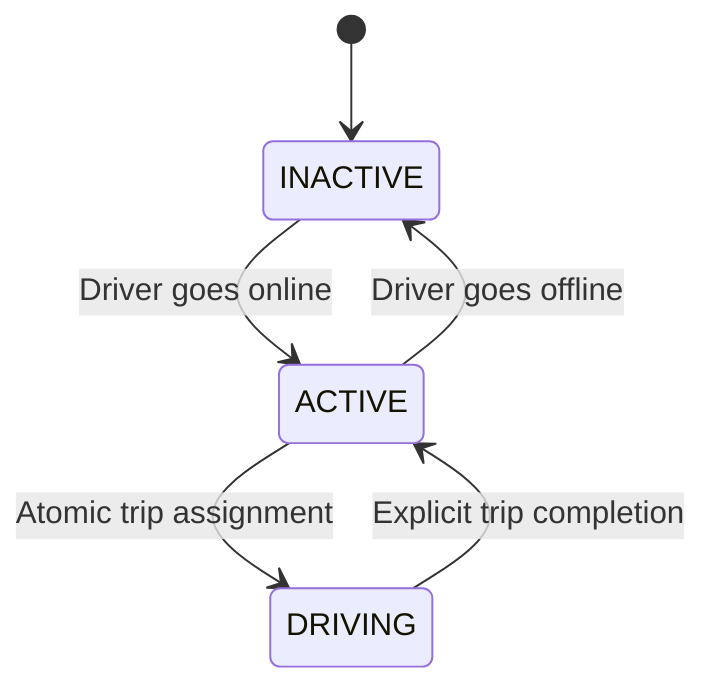

# Uber sample Java backend

A runnable Spring Boot backend for a fleet of 10 drivers. PostgreSQL stores driver profiles. Redis stores GPS locations, live driver state, and trip assignments. Riders send pickup and destination coordinates; the backend atomically assigns the nearest eligible driver.

Java 17+, Spring Boot 3.5.16, Maven, PostgreSQL 17, and Redis 7.4. No paid services or map API keys are required.

## Run

With Docker Compose:

```sh
docker compose up --build -d
curl http://localhost:8080/actuator/health
```

The first build downloads Maven dependencies and container images. Wait for the health endpoint to report `UP`. Flyway creates the driver table and seeds drivers **1–10** with clearly labeled demo profiles. Each driver starts `INACTIVE`, without a GPS location.

To run Java locally instead (Java 17+ and Maven 3.6.3+):

```sh
docker compose up -d postgres redis
mvn spring-boot:run
```

To stop the services while keeping data:

```sh
docker compose down
```

Both databases use named Docker volumes. The Compose password is for local development; set `POSTGRES_PASSWORD` to override it. Published ports bind to localhost.

## Try a trip

1. List the 10 drivers:

```sh
curl http://localhost:8080/api/drivers
```

2. Send driver 1's GPS position, then make them available:

```sh
curl -i -X PUT http://localhost:8080/api/drivers/1/location \
  -H 'Content-Type: application/json' \
  -d '{"latitude":28.6139,"longitude":77.2090}'

curl -X PUT http://localhost:8080/api/drivers/1/state \
  -H 'Content-Type: application/json' \
  -d '{"state":"ACTIVE"}'
```

3. Find available nearby drivers without reserving them:

```sh
curl 'http://localhost:8080/api/drivers/nearby?latitude=28.6139&longitude=77.2090&radiusKm=5'
```

4. Send pickup and destination coordinates to book the nearest driver:

```sh
curl -i -X POST http://localhost:8080/api/trips \
  -H 'Content-Type: application/json' \
  -d '{
    "requestId":"11111111-1111-4111-8111-111111111111",
    "riderId":"rider-1",
    "start":{"latitude":28.6139,"longitude":77.2090},
    "end":{"latitude":28.5355,"longitude":77.3910},
    "radiusKm":5
  }'
```

The `201` response includes a `trip` object and its `driver` profile. The driver's state becomes `DRIVING`. Pickup distance is straight-line distance in kilometers; the destination is stored on the trip, while driver search uses the pickup location. `createdAt` and `completedAt` are Unix milliseconds.

Use a **new UUID for each new booking**. Retrying the same UUID and payload returns the existing trip without reserving another driver. Reusing a successful request ID with different input returns `409`. A request that found no driver does not consume the request ID and may be retried.

5. Complete the trip:

```sh
curl -X POST http://localhost:8080/api/trips/11111111-1111-4111-8111-111111111111/complete
curl http://localhost:8080/api/trips/11111111-1111-4111-8111-111111111111
```

Completion makes the driver `ACTIVE`. Repeating completion is safe, even if the driver has since received another trip. The latest reported driver location is retained; completion does not invent a GPS update at the destination.

Send driver location updates periodically (for example, every 10 seconds). Reports older than **120 seconds** are excluded from nearby search and booking. To take an available driver offline, update their state to `INACTIVE`.

## API

| Method | Endpoint | Behavior |
| --- | --- | --- |
| GET | `/api/drivers` | List PostgreSQL profiles with live Redis state |
| GET | `/api/drivers/{id}` | Get one driver |
| PUT | `/api/drivers/{id}/location` | Store latitude/longitude and heartbeat timestamp; returns `204` |
| PUT | `/api/drivers/{id}/state` | Set `ACTIVE` or `INACTIVE` |
| GET | `/api/drivers/nearby?latitude=...&longitude=...&radiusKm=5` | List fresh active drivers in distance order; observational only |
| POST | `/api/trips` | Receive start/end coordinates and atomically reserve the nearest driver; returns `201` |
| GET | `/api/trips/{requestId}` | Retrieve trip details |
| POST | `/api/trips/{requestId}/complete` | Complete trip and atomically release its assigned driver |
| GET | `/actuator/health` | PostgreSQL/Redis application health |

Latitude must be between `-85.05112878` and `85.05112878` (Redis GEO's supported range); longitude must be between `-180` and `180`. Both coordinates are required. Radius defaults to 5 km and must be greater than 0 and at most 50 km. `riderId` is a nonblank string up to 80 characters. State values are uppercase.

Errors use Spring's JSON Problem Detail response with `status` and `detail`: `400` for invalid input or directly setting `DRIVING`, `404` for missing drivers/trips or no available driver, `409` for request-ID conflicts or availability changes during a trip, and `503` when a required database is unavailable.

## How Redis prevents double booking

Redis GEO uses a sorted set whose scores encode geohashes. [`GEOADD`](https://redis.io/docs/latest/commands/geoadd/) indexes driver locations; [`GEOSEARCH`](https://redis.io/docs/latest/commands/geosearch/) finds nearby drivers and sorts them by distance.

`book.lua` performs all of the following in **one atomic Redis script**:

1. Check for an existing trip with this request ID and validate its payload fingerprint.
2. Search the geospatial index around the rider's pickup location.
3. Select the first `ACTIVE` driver with a recent heartbeat and no current assignment.
4. Set that driver's state to `DRIVING`, record the driver-to-trip mapping, and store the trip.

Redis [guarantees atomic Lua execution](https://redis.io/docs/latest/develop/interact/programmability/eval-intro/). A second simultaneous booking executes after the first and skips the claimed driver. With one available driver, one request succeeds and the other receives `404`. With two available drivers, both can succeed with different drivers. This works across backend instances sharing the same Redis database; it uses no in-memory application locks.

State changes and trip completion also use Lua. GPS updates never reset availability. App startup initializes missing states with `HSETNX`, preserving existing assignments. Drivers stay `DRIVING` until explicit completion; no timeout can silently release a driver during a trip.



PostgreSQL is the source of truth for profile information; Redis is the source of truth for live dispatch state. State is deliberately not duplicated in PostgreSQL, avoiding an unsafe transaction spanning two databases. All dispatch keys share the `{dispatch}` Redis Cluster hash tag:

| Redis key | Type | Contents |
| --- | --- | --- |
| `uber:{dispatch}:locations` | GEO sorted set | Driver ID → geohash-encoded coordinates |
| `uber:{dispatch}:states` | Hash | Driver ID → `ACTIVE`, `INACTIVE`, `DRIVING` |
| `uber:{dispatch}:updated-at` | Hash | Driver ID → last heartbeat in milliseconds |
| `uber:{dispatch}:driver-trips` | Hash | Assigned driver ID → request/trip UUID |
| `uber:{dispatch}:trips` | Hash | Request/trip UUID → trip JSON and internal payload fingerprint |

## Configuration

| Environment variable | Default |
| --- | --- |
| `DB_URL` | `jdbc:postgresql://localhost:5432/uber` |
| `DB_USERNAME` | `uber` |
| `DB_PASSWORD` | `uber-local` |
| `REDIS_HOST` | `localhost` |
| `REDIS_PORT` | `6379` |
| `REDIS_PASSWORD` | Empty |
| `PORT` | `8080` |
| `LOCATION_MAX_AGE_SECONDS` | `120` |

## Tests

```sh
mvn test                     # Input-validation unit tests; no databases required
mvn verify -Pintegration     # Unit tests plus real PostgreSQL/Redis HTTP integration tests
```

Integration tests require a running Docker daemon. Testcontainers creates isolated databases; it does not modify the Compose databases. On Linux with multiple Docker contexts, set `DOCKER_HOST` to your active daemon's socket (for example, `unix:///var/run/docker.sock`). GitHub Actions runs the full suite with Java 17.

Coverage includes nearest eligible driver selection, stale/inactive/missing locations, two simultaneous riders competing for one driver, 20 concurrent riders competing for 10 drivers, concurrent retries of one request, conflicting request-ID reuse, trip completion retries, startup/heartbeat state preservation, and invalid API input.

## Sample scope

This sample immediately assigns a driver without an acceptance step. It has no authentication, fare calculation, road routing, or cancellation workflow. Driver metadata is durable in PostgreSQL; trips and live state are retained in Redis. Compose enables AOF with an approximately one-second persistence window and `noeviction`. A Redis data loss or failover can lose recent assignments, so production dispatch needs reconciliation and a durable trip ledger before accepting new work after recovery. Completed trips remain in Redis to preserve idempotency; a production system also needs archival and a defined retry-retention policy.

The single shared Redis slot and an uncapped candidate scan suit the requested 10-driver fleet. A large fleet needs regional partitioning and a bounded search strategy. Nearby-search results are snapshots; only the booking endpoint guarantees reservation.
